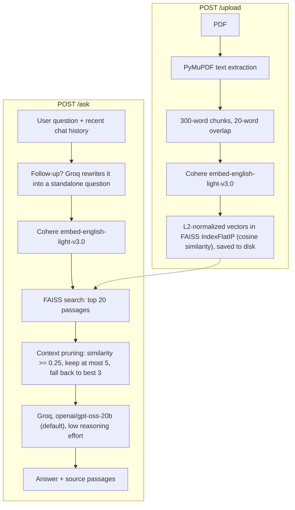

# DocsMind

**Ask your PDF anything. Get answers, not buffering.**

DocsMind is a question-and-answer assistant for PDFs. Upload a document, ask questions about it in plain language, and get answers built from that document, with the passages each answer came from shown next to it. Follow-up questions like "explain that more simply" work too.

Live demo: https://docsmind.vercel.app

<!-- Screenshot: home page (docs/screenshots/hero.png) -->

## The problem

People often need answers from one specific document: a textbook chapter, a manual, a policy or a report. General-purpose chatbots answer from general knowledge rather than from that document, and there is no easy way to check where an answer came from. DocsMind builds every answer from the uploaded PDF and shows the passages it used, so the answer can be checked against the document.

DocsMind started as VidyaAI, a study tool for school students. The project was renamed and opened up to any PDF in October 2026.

## What it does

- **Answers from the uploaded document.** Each answer is generated from passages retrieved from the uploaded PDF. The passages used are shown next to the answer, and sentences that share key words with the question are highlighted so the answer can be checked against the document.
- **Follow-up questions.** The chat remembers the last three questions and answers, so "explain that more simply" or "what is its focal length?" know what was asked before.
- **Fast and cheap answers.** Only the few passages a question needs are sent to the language model, the frontend bundle is small, fonts are self-hosted, and the app says when the server is waking up instead of leaving the user waiting silently.

<!-- Screenshot: chat with an answer and its source passages (docs/screenshots/chat.png) -->

## How it works



1. **Upload.** The PDF's text is extracted with PyMuPDF, flattened into one stream of words, and split into 300-word passages with a 20-word overlap. Each passage is embedded with Cohere's `embed-english-light-v3.0` model. The vectors are L2-normalized and stored in a FAISS `IndexFlatIP` index, so inner product equals cosine similarity. The index and passages are written to `backend/faiss_store/`.
2. **Ask.** If the question is a follow-up, a small Groq call first rewrites it into a question that makes sense on its own (see below). The question is embedded with the same Cohere model, and FAISS returns the 20 most similar passages. These are pruned (see below), and the remaining passages are sent to Groq along with a system prompt that tells the model to use only the given context, to say so when the answer is not there, and to write formulas as plain text. The model defaults to `openai/gpt-oss-20b` and can be changed with the `GROQ_MODEL` environment variable. The response contains the answer, the passages used with their similarity scores, how many passages were checked and kept, and the question that was searched for.

### Context pruning

`backend/pruner.py` decides which of the 20 retrieved passages reach the model:

1. Drop every passage whose cosine similarity to the question is below the threshold (0.25 by default).
2. If no passage passes, keep the 3 most similar passages instead, so the model always has some context.
3. Sort what is left by similarity and keep at most 5.

Passages are ranked by similarity score only. A reranking model would likely pick better passages, but it was left out to keep the project within free-tier API limits.

### Conversation memory

The history lives in the browser. With each question, the frontend sends the last three question-and-answer pairs (answers only, no error messages or sources). The backend stays stateless and caps the history itself: at most 6 messages, each cut to 1,500 characters.

- **Query rewriting.** A follow-up such as "what is its focal length?" makes a poor search, because "its" means nothing on its own. When there is history, one small Groq call rewrites the question into a standalone one, such as "What is the focal length of a convex lens?", and that is what FAISS searches for. If the rewrite fails or times out (no retries, 5-second limit), the original question is used. A follow-up costs about 0.4 seconds and about 50 output tokens for the rewrite.
- **Answering.** The answer call sees only the last question and answer, as real chat messages, plus the passages and the user's own question.

## Evaluation

`evals/followup_facts.py` checks whether follow-up answers add facts that are not in their passages. In October 2026, 4 of 15 follow-up answers stated a wrong fact (one chapter, a small sample). See [evals/README.md](evals/README.md) for how to run it, the labelling rules and the detailed results.

## Results

| Measure | Result |
| --- | --- |
| Latency with context pruning | About 35% lower than sending all 20 passages |
| Text sent to the model per question | About 1,500 words instead of about 6,000 (about 75% less) |
| Typical answer time | About 1.4 s once the server is awake |
| Example: NCERT Class 10, "Light – Reflection and Refraction", question "What is 1 dioptre?" | 20 passages checked, 1 sent to the model |
| Extra cost of a follow-up question | About 0.4 s and about 50 output tokens for the rewrite |
| Follow-up answers with a wrong fact | 4 of 15 (one chapter, small sample) |
| Frontend JavaScript bundle after the redesign | 370 KB to 221 KB (about 40% smaller), 73 KB compressed |
| Accessibility | All text meets WCAG AA contrast in light and dark themes, with visible keyboard focus |

## Tech stack

**Backend**
- Python 3.12 (on Render), FastAPI, Uvicorn
- PyMuPDF for PDF text extraction
- Cohere `embed-english-light-v3.0` for embeddings
- FAISS (`faiss-cpu`) for vector search, NumPy
- Groq API for the language model (`openai/gpt-oss-20b` by default)
- python-dotenv, python-multipart, httpx

**Frontend**
- React 18 and Vite 5
- Tailwind CSS v4 (via `@tailwindcss/vite`)
- axios for API calls, lucide-react for icons
- Noto Sans and Noto Serif, self-hosted through `@fontsource`
- Light and dark themes, following the system setting with a manual toggle

**Hosting**
- Frontend on Vercel
- Backend on Render

## Running locally

### Backend

Requires Python 3.10 to 3.12, plus a Groq API key and a Cohere API key. The pinned versions of NumPy and PyMuPDF do not ship wheels for Python 3.13 or newer.

```bash
cd backend
python -m venv venv
```

Activate the virtual environment:

```bash
# Windows
venv\Scripts\activate

# macOS / Linux
source venv/bin/activate
```

Install dependencies:

```bash
pip install -r requirements.txt
```

Create `backend/.env`:

```env
GROQ_API_KEY=your_groq_api_key
COHERE_API_KEY=your_cohere_api_key

# Optional. Defaults to openai/gpt-oss-20b.
GROQ_MODEL=openai/gpt-oss-20b
```

Start the server from the `backend/` folder (the index is stored in `faiss_store/` relative to the current directory):

```bash
uvicorn main:app --reload
```

The API runs at http://127.0.0.1:8000, and interactive API docs are at http://127.0.0.1:8000/docs.

### Frontend

```bash
cd frontend
npm install
npm run dev
```

The app runs at http://localhost:5173.

By default the frontend calls the deployed backend. To use your local backend, copy `frontend/.env.example` to `frontend/.env.development.local`, which sets:

```
VITE_API_BASE=http://127.0.0.1:8000
```

Restart `npm run dev` after creating or changing the file. Only the dev server reads it; `npm run build` always uses the deployed backend. The file is git-ignored.

## Limitations and next steps

- **One shared index.** There is a single FAISS index for all users, so each new upload replaces the previous document for everyone. Per-user or per-document indexes are the next step.
- **Uploads do not survive restarts.** The index is stored on Render's temporary disk and is lost when the server restarts or redeploys; the user then has to upload the document again. After a restart, the first request can take up to a minute.
- **PDF extraction is imperfect.** Formulas, tables and page headers often come out garbled. Page numbers are not kept, so sources cannot point to a page. Scanned PDFs without a text layer are rejected, since there is no OCR.
- **Broad questions are weak.** Questions like "summarize this chapter" do not match any single passage well, so the model often sees only the 3 best passages and gives a partial answer.
- **Pruning uses only the similarity score.** A hosted reranker would help choose better passages.
- **The model does not always follow the prompt.** It can add facts that are not in the passages, mix up two parts of the passages, or write formulas in LaTeX despite being told not to. See [Evaluation](#evaluation).
- **Short memory.** The chat remembers only the last three questions and answers, and reloading the page forgets them. If a follow-up is rewritten wrongly, the search uses the wrong question.
- **No streaming.** The answer appears only once it is complete.
- **English-only embeddings.** `embed-english-light-v3.0` is an English model, so retrieval from documents in Hindi or other languages is likely to be poor.
- **Keep-alive URL is hardcoded.** The server pings the deployed Render URL every 10 minutes to stay awake, including when run locally.
- **No authentication or upload size limit**, CORS accepts any origin, and there is no automated test suite.

## License

MIT. See [LICENSE](LICENSE).

Built by [Sourabh Saxena](https://github.com/sourabh-550).
